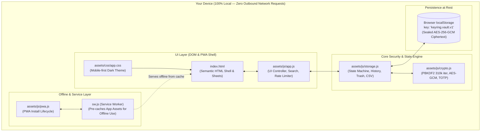

# Keyring — your own password vault

> 🚀 **Live App / Install URL:**  
> ### 👉 **[https://rahulkapse17.github.io/keyring/](https://rahulkapse17.github.io/keyring/)** 👈  
> *(Open this link on your phone or computer to use or install the app)*

A complete, installable password manager that runs entirely on your phone.
No account, no server, no subscription, no tracking. Your vault is encrypted
on the device with **AES-256-GCM** and the key is derived from your master
password, which is never stored anywhere.

Because it is a web app (PWA), the same build installs on **Android, iPhone and
desktop** from a single URL, and works completely offline afterwards.

---

## Architecture Diagram



---

## What it does

| Feature | Detail |
|---|---|
| **Save logins** | Title, username/email, password, website, category, tags, free-form notes |
| **2FA / TOTP Authenticator** | Built-in RFC 6238 two-factor code generator with live 30s countdown and copy |
| **Password History** | Automatically preserves previous passwords per entry to prevent accidental lockout |
| **Soft Delete (Trash)** | Deleted entries move to Trash with restore or permanent wipe options |
| **CSV Import** | Import logins directly from Google Chrome, Firefox, Bitwarden, or 1Password |
| **Copy anything** | One-tap copy for username, password, website, notes, or 2FA code |
| **Clipboard auto-clear** | Copied passwords are wiped from the clipboard after 15 s / 30 s / 60 s / 2 min |
| **Edit** | Every field editable, with a change history stamp (`Updated 3h ago`) |
| **Delete** | Two-step confirmation with safety checks |
| **Search** | Instant search across title, username, website, notes, category and tags |
| **Organise** | Categories (Email, Banking, Social, Work, Shopping, Dev…), multi-tag support, favourites |
| **Password generator** | Random strings (length + character classes + avoid look-alikes) or memorable passphrases |
| **Vault health** | Flags weak and reused passwords at a glance |
| **Auto-lock & Rate Limiting** | Locks after inactivity; exponential cooldown on failed unlock attempts |
| **Masked by default** | Passwords are hidden in the list and revealed only on request (auto-hides after 30 s) |
| **Encrypted backup** | One `.json` file you can move to any other phone or PC and import |
| **Master password change** | Re-keys the whole vault (and re-encrypts every entry) |
| **Works offline** | Service worker caches the entire app; no network required after first load |
| **No plaintext on disk** | Titles, usernames, passwords, notes, and preferences never appear unencrypted |

---

## Security model — read this once

**What protects you**

- Your master password is stretched with **PBKDF2-SHA256, 310,000 iterations**, then used as an
  **AES-256-GCM** key. The key exists only in RAM while the vault is unlocked; it is
  created as a *non-extractable* `CryptoKey`, so script cannot read the raw bytes back out.
- A fresh random salt (16 bytes) and IV (12 bytes) are used for every encryption.
- The stored blob is `{kdf, salt, iv, data}` — without the master password it is
  indistinguishable from random noise. Copying it, syncing it or emailing it leaks nothing.
- GCM authentication means a tampered or corrupted vault fails to open instead of
  silently returning wrong data. The test suite covers this.
- Settings live *inside* the ciphertext, so the blob does not even reveal your preferences.
- Everything runs locally. The app makes **zero network requests** — you can verify this
  in your browser's Network tab.

**What it cannot protect you from**

- **A forgotten master password is unrecoverable.** There is no reset, no "security
  question", no support inbox. This is the point. **Export a backup** and keep it somewhere
  safe (and remember that backup's password too — it is encrypted with the same one).
- A **compromised device** (malware, a rooted phone, someone who installs a keyboard logger)
  or a **shoulder-surfer** while a password is revealed.
- Browser-level threats on shared machines. Don't open your vault on a computer you don't trust.
- Clearing your browser's site data for this app deletes the vault. Backups are your friend.

**Sensible habits**

1. Use a long master password (a 4–5 word passphrase is both strong and typable).
2. Export a backup right after you add a batch of passwords.
3. Keep the backup file somewhere you trust — it is encrypted, so even a cloud drive is fine,
   as long as the master password is not stored next to it.

---

## Install it on a phone

Open the live URL: **[https://rahulkapse17.github.io/keyring/](https://rahulkapse17.github.io/keyring/)**

### Android (Chrome, Edge, Samsung Internet)

1. Open **[https://rahulkapse17.github.io/keyring/](https://rahulkapse17.github.io/keyring/)** in Chrome.
2. Tap the **Install** icon in Keyring's top bar — or tap the ⋮ menu → **Install app** / **Add to Home screen**.
3. Launch it from the home-screen icon: full screen, no address bar, works 100% offline.

### iPhone / iPad (Safari)

1. Open **[https://rahulkapse17.github.io/keyring/](https://rahulkapse17.github.io/keyring/)** **in Safari** (must be Safari, not Chrome/Instagram).
2. Tap the **Share** icon at the bottom (`[↑]`) → **Add to Home Screen** → **Add**.
3. Launch it from the home-screen icon.

> iOS note: Safari can evict website storage for sites you barely use. Installing to the
> home screen makes this much less likely — and regular exports cover the rest.

### Desktop

Chrome/Edge: the install icon in the address bar. The layout adapts to wide screens.

---

## Moving your vault to a new phone

1. **Old phone** → Settings → **Export backup** → *Download backup file*.
   You get `keyring-backup-YYYY-MM-DD-HHMM.json`.
2. Send that file to the new phone however you like — WhatsApp to yourself, Google Drive,
   email, AirDrop, USB cable. It is encrypted, so the channel does not matter.
3. **New phone** → open Keyring → **Settings → Import backup** → choose the file →
   type the master password that was active when the backup was made.
4. Pick **Merge** (keep what is here, add the rest) or **Replace** (start from the backup).

Importing the same file twice is safe: duplicates are detected and skipped.

---

## Run it locally

The folder is a static site — no build step, no dependencies.

```bash
cd keyring
python3 -m http.server 8899 --bind 0.0.0.0     # or: npm start
# open http://localhost:8899
```

To install it on a phone on the same Wi-Fi, use your computer's LAN IP
(`http://192.168.x.x:8899`). Note that **https or localhost is required** for
WebCrypto: plain `http://` on a LAN IP will show "Encryption unavailable"
(service workers and `crypto.subtle` need a secure context). Deploy the folder to
any static host — GitHub Pages, Netlify, Vercel, Cloudflare Pages — to get https.

### One-file version

`../Keyring-standalone.html` (139 KB) is the entire app — CSS, JS and icons inlined —
in a single file you can email, put on a USB stick, or drop on any web host.
Installation as a home-screen app needs the folder version; the single file works
perfectly as a normal web page.

Rebuild it after changing sources:

```bash
node tools/build-standalone.mjs
```

---

## Project layout

```
keyring/
├── index.html                 # markup: gate, app shell, sheet container, icon sprite
├── manifest.webmanifest       # PWA metadata, icons, "Add password" shortcut
├── sw.js                      # service worker — offline cache
├── assets/
│   ├── css/app.css            # mobile-first dark theme, sheets, safe-area handling
│   └── js/
│       ├── crypto.js          # PBKDF2 + AES-GCM, generator, entropy estimation
│       ├── storage.js         # encrypted envelope, CRUD, settings, backup/import
│       ├── pwa.js             # install prompt + service worker registration
│       └── app.js             # UI: gate, list, sheets, search, auto-lock
├── icons/                     # generated PNG/SVG app icons
└── tools/
    ├── make_icons.py          # regenerates every icon
    ├── build-standalone.mjs   # inlines everything into one HTML file
    ├── test-logic.mjs         # 67 crypto/storage tests against the real modules
    ├── test-ui.mjs            # 64 DOM tests driving index.html in jsdom
    ├── test-standalone.mjs    # smoke test of the single-file build
    └── screenshots.mjs        # Playwright walkthrough (needs a browser)
```

### Commands

```bash
npm test          # crypto + storage (node, no browser needed)
npm run test:ui   # full UI flow in jsdom
npm run icons     # regenerate app icons
npm run screenshots   # optional: real-browser screenshots into shots/
```

---

## Test status

```
67 logic tests   crypto primitives, vault lifecycle, CRUD, settings,
                 backup export/import, master-password change, diagnostics
64 UI tests      setup, add, search, filters, detail, reveal, favourite,
                 edit, generator, settings, export, import validation,
                 delete, lock/unlock, and two regression suites that guard
                 the sheet-close and stale-listener bugs found during the build
```

All 131 tests pass with zero console errors. They are grey-box tests: they load
the real `crypto.js` / `storage.js` / `app.js` and drive the real `index.html`.

---

## Keyboard & power-user touches

- `Ctrl/Cmd + K` — jump to search
- `Esc` — close the open sheet
- `Enter` on a focused card — open the entry
- **Merge import** de-duplicates on title + username + password
- **Replace import** wipes and restores, useful for migrating a whole vault

---

## License

Do whatever you like with it. It is your vault.
